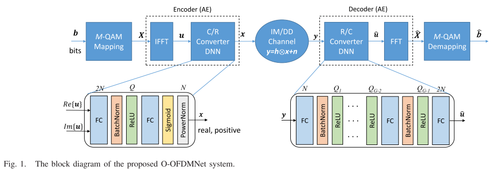
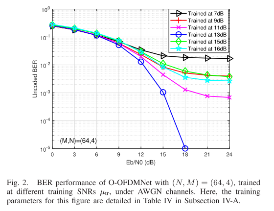
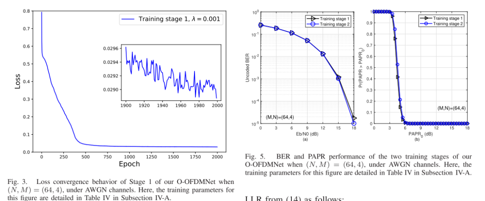
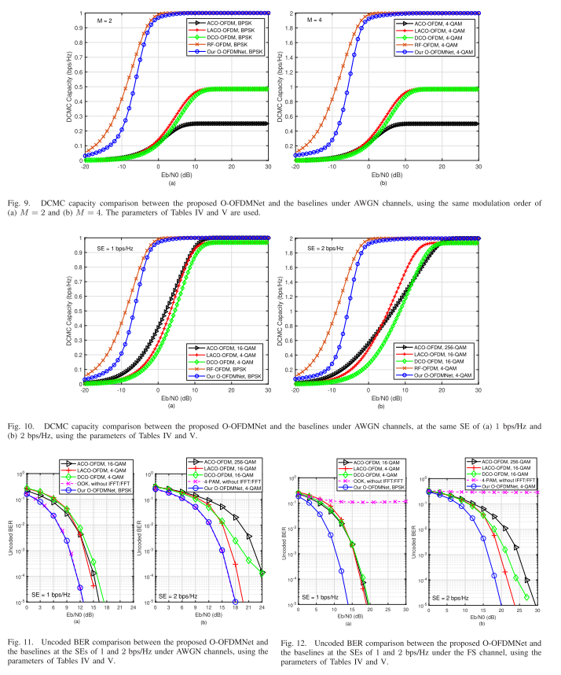
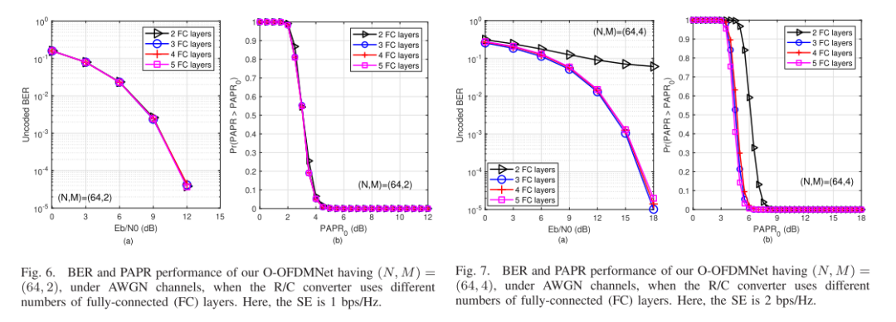
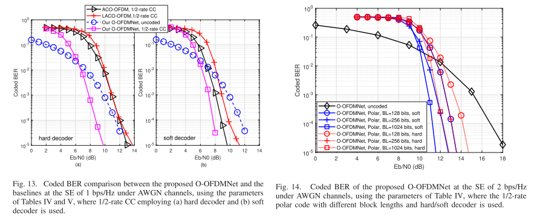
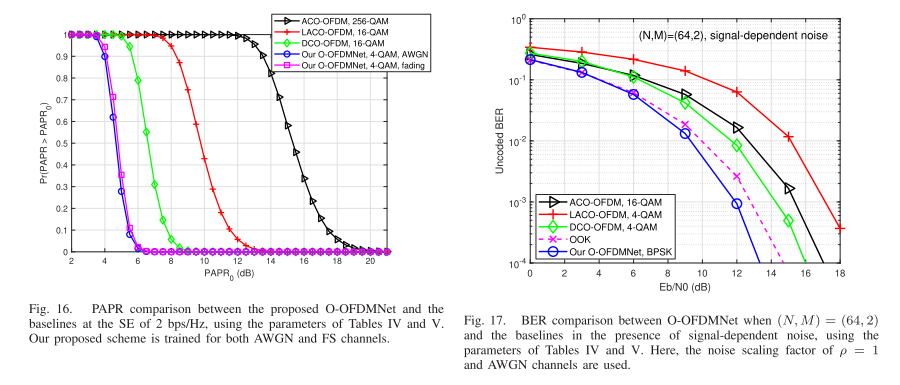

# Deep Learning + OFDM: Deep Learning-Assisted Approach to Implementing IM/DD OFDM Closer to RF-OFDM with MATLAB Code

Introduction Orthogonal Frequency Division Multiplexing (OFDM) has been widely adopted in wireless communication systems [1] and [2], where radio frequency (RF) hardware can support complex signal processing [3] and [4]. As an evolution of RF-OFDM, Optical OFDM (O-OFDM) for visible light communication (VLC) and fiber optics has been proposed to leverage its robustness against intersymbol interference (ISI) and simplicity of single-tap channel equalization under dispersion channels. In VLC, as well as in free space optical (FSO) and fiber optics communications, low complexity intensity modulation is typically used in conjunction with direct detection (IM/DD), which requires the transmitted signals to be real and positive. To explain, in IM/DD systems, the intensity of the emitted optical wave is used to modulate the signal, while at the receiver, a photodetector is employed to convert the optical signal back into the electronic domain. In this context, significant efforts have been made to modify RF-OFDM to create real positive signals in the time domain (TD), after the Fast Fourier Transform (FFT) or Inverse Fast Fourier Transform (IFFT), which are bipolar and complex operations [5].
Frequency domain (FD) Hermitian symmetry constraints are commonly used in conjunction with Normalization Amplitude Modulation (QAM) to ensure that the TD modulated signal after IFFT is real valued. However, we still need to eliminate the negative part of the signal after IFFT. Inspired by this, Carruthers and Kahn proposed the DC biased OFDM (DCO-OFDM) concept in [7], which adds a DC bias to the bipolar real-valued post-IFFT signal, making most of the samples positive, while the remaining low amplitude negative samples can be clipped to zero. A careful selection of DC bias is necessary to minimize non-linear clipping distortion. In [8], it is suggested that the DC bias of DCO-OFDM should be at least 10 dB higher than the data-carrying bipolar signals. Therefore, DCO-OFDM has low power efficiency due to the wasted DC bias. Therefore, Armstrong and Lowery proposed the asymmetrical clipped OFDM (ACO-OFDM) [9] to improve power efficiency (PE) at the cost of spectral efficiency (SE). Explanation: The ACO-OFDM signal is transmitted only on the subcarriers with odd indices, where the M-ary symbols are arranged to obey Hermitian symmetry. The subcarriers with even indices do not carry any useful payload. The design allows ACO-OFDM to limit the IFFT signal to zero without any information loss, as the resulting nonlinear clipping distortion product only falls on the non-active subcarrier. A similar scheme is proposed in [10] called Pulse Amplitude Modulation Discrete Multitone (PAM-DMT) configuration, which modulates the imaginary part of the subcarrier and makes its real part blank. Note that although ACO-OFDM and PAM-DMT completely eliminate DC bias, they only achieve half of the SE of DCO-OFDM. Therefore, various hybrid schemes have been proposed in [11] and [12], which combine the above-mentioned methods for combine harvesters. These hybrid schemes have a fixed SE, which depends on the specific choice of the composition schemes, but they cannot exceed the SE of DCO-OFDM. To achieve a flexible compromise between SE and PE, Wang et al. proposed the Hierarchical ACO-OFDM (LACO-OFDM) [13], which utilizes non-active subcarriers in ACO-OFDM to incorporate an additional ACO layer. By increasing the number of ACO layers, LACO-OFDM increases SE to nearly half that of RF-OFDM by increasing complexity at the transceiver level due to the need for more IFFT/FFT operations [14]. Furthermore, in [15]-[17], the LACO-OFDM with combined channel coding has been thoroughly studied and its capacity has been derived in [18].
From a historical perspective, the study of learning-assisted wireless transceivers has been ongoing for 30 years [19]-[21]. However, by the time this article was written, deep learning (DL) had found numerous further applications in communication systems. For example, deep neural networks (DNNs) have been used for channel estimation and signal detection in both classical RF-OFDM [23] and OFDM with index modulation [24]. In [25], DL was reported to be applied in systems based on non-coherent energy detection, where both transmitters and receivers are modeled by DNNs based on autoencoder (AE) structures, promoting joint optimization of the transceivers through end-to-end training. Similarly, in [26], systems based on coherent multicarrier AE were proposed, maximizing diversity and coding gain over fading channels. DL has also been applied to optical communications. For instance, in [27], Amran et al. designed an DL-aided detection scheme for indoor VLC systems using DCO-OFDM, achieving near-optimal maximum likelihood detector BER. In [28], the AE structure was applied to the key control (OOK) transceivers of a tunable VLC system. Similarly, in [29], a recurrent neural network-based AE was used in a system based on optical IM/DD fibers. Moreover, in [30], an end-to-end AE-based VLC system was proposed for reducing flicker and dimming. In [31], a hybrid AE scheme was introduced for an ACO-OFDM-based VLC system to improve the bit error rate (BER) and peak-to-average power ratio (PAPR) of the classic ACO-OFDM, while in [32], DL was employed in a multicolor VLC system to reduce symbol error probability.
It is noteworthy that due to the FD Emmitt symmetry constraints, all existing O-OFDM systems can only achieve half of the RF-OFDM's SE. Additionally, they suffer from high PAPR inherited from OFDM's IFFT-based modulation, leading to severe nonlinear signal distortion and thus reducing system performance. Note that since the TD signals of O-OFDM must be real and positive, some PAPR reduction methods [33] and [34] designed for RF schemes are not applicable. Recently, LACO-OFDM has been shown to reduce the peak-to-average power ratio (PAPR) by increasing the number of layers compared to ACO-OFDM [14]. However, this comes at a significant increase in transceiver complexity. Moreover, recalling DCO-OFDM schemes have low power efficiency due to their excessive DC bias requirements. Therefore, in this regard, we contribute by applying the assistance of an DL-AE structure to O-OFDM. Our new contribution boldly and explicitly contrasts with literature in Table I, summarizing as follows:
·This paper proposes an O-OFDMNet scheme with DL assistance, which utilizes DNNs based on AE structures to encode and detect the IFFT-post-TD modulated signals of O-OFDM. To generate real values and positive symbols in TD, the classic S-shaped activation [22] is used as the output layer of the transmitter DNN. Compared to existing O-OFDM schemes [7]-[14], this design completely eliminates the requirement for Emmitt symmetry, thus matching the final SE of RF-OFDM. In other words, since O-OFDMNet's FD signal processing is the same as that of classical RF-OFDM, all available subcarriers are effectively utilized to carry QAM data symbols.
· The proposed O-OFDMNet is trained to simultaneously minimize both the Bit Error Rate (BER) and Peak-to-Average Power Ratio (PAPR) in additive white Gaussian noise (AWGN) and frequency selective (FS) channels. Simulation results show that the proposed scheme can significantly improve the system's bit error rate and peak-to-average power ratio. Additionally, our proposed scheme closely approximates the throughput of RF-OFDM while significantly surpassing existing O-OFDM solutions. Another unique contribution is that we fundamentally combine O-OFDMNet with convolutional codes and polarization codes, using both hard and soft decoding.
· We analyzed the complexity of O-OFDMNet and compared it with existing O-OFDM solutions, indicating that given its moderate complexity, our approach is well-suited for real-time applications. Our numerical results quantify the throughput of our O-OFDMNet under AWGN and frequency selective channels, uncoded/coded BER, PAPR, and operational time complexity, outperforming existing O-OFDM solutions. Moreover, our results suggest that our plan is more robust in practical optical channel conditions, such as signal-dependent noise and nonlinear clipping distortion, compared to baselines.
Article illustration
Conclusion: We propose a novel DL-assisted O-OFDMNet concept that employs DNN as the C/R and R/C converters, respectively processing TD signals in both transmitters and receivers. This new design enables O-OFDMNet to bypass the need for Hermitian symmetry, thereby achieving the same SE as classical RF-OFDM, something that has never been achieved with existing O-OFDM solutions. Additionally, compared to systems based on DCO-OFDM, our approach is more power-efficient since it does not require DC biasing to generate positive transmit signals. O-OFDMNet is trained to jointly minimize BER and PAPR over AWGN and frequency-selective channels. We also derive the soft decoder for this scheme and apply it to convolutional codes and polar codes, further improving the bit error rate. Simulation results show that O-OFDMNet effectively reduces the baseline bit error rate and peak-to-average power ratio under both uncoded and coded conditions. Moreover, the DCMC capacity of our scheme approaches that of RF-OFDM, which is already available in higher-level O-OFDM solutions. Our O-OFDMNet is also more robust against harmful signal-related noise and nonlinear clipping distortion. Finally, our complexity analysis indicates that our scheme adds extra DNN complexity, but its IFFT/FFT complexity is similar to that of DCO/ACO-OFDM, lower than LACO-OFDM. Analysis also shows that O-OFDMNet can fully leverage the parallel processing capabilities of DNN, running faster than baseline algorithms. In future work, we plan to validate our scheme in indoor environments.

## Images

<!-- PAYMENT_BLOCK -->

## Get this dataset

- Payment link (Stripe): [Buy now](https://buy.stripe.com/3cs8yP7sY87d0vu9AB)
- Payment QR code: 

<!-- /PAYMENT_BLOCK -->
